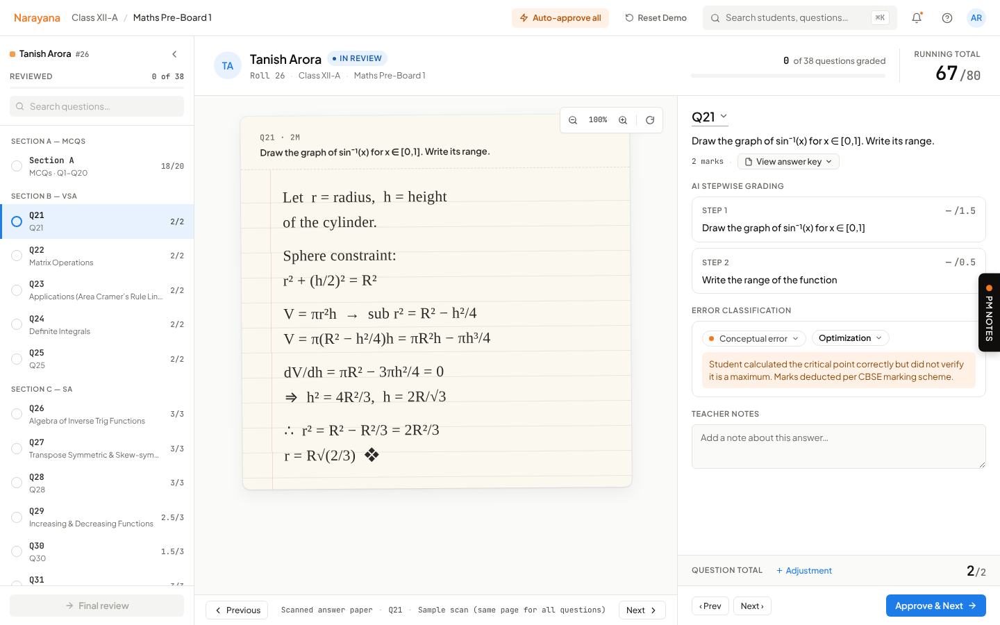
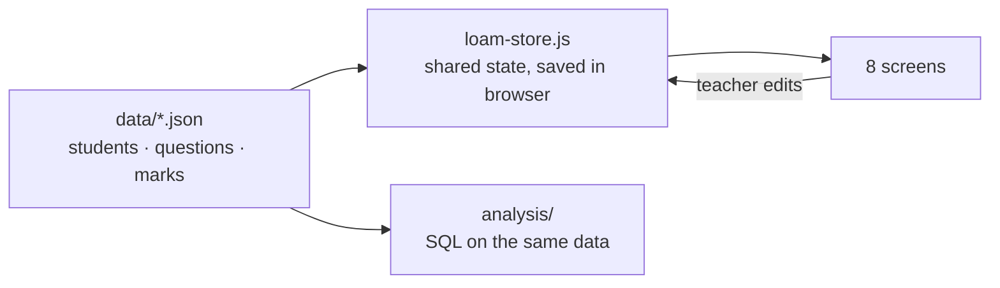

# LOAM: AI-assisted grading for CBSE Maths teachers

**The AI marks the papers step by step, and the teacher only checks what matters.** This clickable prototype pitched LOAM to Narayana Educational Institutions and won a **$300K/year** contract.

**▶ [Take the guided tour (3 min)](https://shrishtiruia.github.io/AI-GRADING-DEMO/)**. Every screen has a *PM notes* panel explaining the decision behind it.

| | |
|---|---|
| **Problem** | Class XII pre-board papers are marked step by step, by hand. That's 38 questions × 30+ students per section, and a school chain can't see whether its teachers mark consistently. |
| **Users** | The **teacher** uses it. **School leadership** buys it. The design had to win both. |
| **What I built** | An 8-screen prototype: load the rubric → AI grades → bulk-approve MCQs → review written answers step by step, with low-confidence flags → class complete. |
| **My role** | **Lead PM, end to end.** Wrote and scoped the brief, defined the data model, pulled the demo data from production, built and tested the prototype with Claude Design, ran the pitch, and owned post-sales. |
| **Result** | **Won a $300K/year contract** with Narayana Educational Institutions, one of India's largest education groups ([900+ institutions in 250+ cities across 23 states](https://en.wikipedia.org/wiki/Narayana_Educational_Institutions)). |

---

## 1. Start from the data

Before designing the review flow, I looked at how one real Class XII Maths pre-board gets marked: **30 students, 38 questions, 1,140 answers.** ([SQL](analysis/queries.sql) · [results](analysis/results.md))

| Finding | So the product… |
|---|---|
| **MCQs are 53% of the answers a teacher checks, but 25% of the marks.** | approves all 20 MCQs in one click. Teacher time goes to written answers. |
| **41% of written answers got part marks.** In the 3-, 4- and 5-mark sections, it's about half. | marks **step by step**, with a reason per step. A right/wrong AI would be useless here. |
| **4 of 30 students are below the 33% pass mark.** "Application of Derivatives" lost the most marks. | treats grading data as the input for the next product: class analytics. |

## 2. Three decisions

**① Load the school's rules before grading anything.**
LOAM first reads the CBSE marking scheme, the teacher's step-wise answer key and the school's own guidelines. In the pitch, Narayana's guidelines were dropped in live, and LOAM picked up their partial-credit rules.
*Why:* the buyer's first question is "will it mark the way **we** mark?" This answers it before a single paper is graded.

**② Check only what the AI isn't sure about.**
MCQs are approved as a block, and the teacher scans for red rows. On written answers, the AI flags the ones it's unsure about (long answers with part marks) with an orange **Low confidence** banner, so the teacher knows where to look first. From the brief: *"We don't ask you to verify what AI is sure about. We ask you to verify what it isn't."*
*Trade-off:* bulk approval risks rubber-stamping. The final review screen shows all 38 questions with their status before anything is submitted.

**③ Every mark has a reason, and every mark can be changed.**
Written answers show AI marks per step, with the reason for each deduction. The teacher can edit any step, tag the error type (conceptual, calculation…) and add a note.
*Why:* teachers won't accept marks they can't see the logic behind. The error tags double as the data for class-level analytics.

Design system rules that came out of this ([see page](design-system.html)): the grading workspace is dense and plain because teachers spend hours in it. Orange is used only for final actions, at most once per screen. Light grey is never used for text, since teachers read dense marks tables for long stretches.

## 3. Scope: what went in the pitch, and what I held back

The brief ([docs/design-brief.md](docs/design-brief.md)) planned 13 screens. **I demoed 8**, the core grading loop, and deliberately kept the rest out of the base deal as a **premium bundle**.

| | What's in it | Why |
|---|---|---|
| **Base product** (demoed) | AI step-wise grading, teacher review with low-confidence flags, class summary. Results go to students and parents. | This is the core value, and where the buying decision gets made. |
| **Premium bundle** (held back) | Student report with **regrade requests** (3 screens), plus **integration with Narayana's own systems** (marks synced into nLearn) | These matter most to a large chain running exams at scale. Pricing them as an upgrade grows the account after the first deal, instead of giving them away up front. |

## 4. How I'd measure success in a pilot

| | Metric | Why |
|---|---|---|
| **North star** | Teacher hours saved per exam cycle | The value the buyer is paying for |
| **Trust** | % of AI marks accepted without edits, per question type | Low → AI or rubric needs work. Suspiciously high → teachers may be rubber-stamping. |
| **Quality** | Agreement between LOAM and a second human marker | Speed is worthless if the marks are wrong |
| **Adoption** | % of teachers who use LOAM again next exam | The real test of whether it saved time |
| **Guardrail** | Regrade requests per 100 papers | Catches marking errors that reach students |

The "9h 12m saved" on the last screen is an **illustrative estimate for the pitch**. The pilot would replace it with a measured number.

## 5. Risks and what's next

- **Handwriting OCR is the biggest risk.** Everything depends on reading messy handwritten maths correctly. I'd measure accuracy per question type before promising time saved.
- **These are minors' marks.** A real rollout needs consent, role-based access and audit logs, and must comply with India's DPDP Act.
- **Next: class analytics.** The error tags and step marks collected while grading show *which concept* the class is losing marks on, not just who scored low.

## 6. How it's built

Built with **Claude Design** (AI-assisted). It's plain HTML/CSS/JavaScript with no backend: the "AI grading" is simulated, using real exam marks (student names changed).

- **Data is separate from screens.** Every number comes from three JSON files, mapped field by field in [docs/data-mapping.md](docs/data-mapping.md).
- **One shared state.** Edit a step mark on one screen, and the student's total updates everywhere. It's saved in the browser, so a refresh mid-pitch doesn't wipe the demo. Spec: [docs/state-management-spec.md](docs/state-management-spec.md).
- **Run the analysis:** `python3 analysis/run_queries.py`. **Run the demo locally:** `python3 -m http.server` then open `localhost:8000`.

---

*Student names are invented. Marks pattern is from a real pre-board exam.*
